<a href="https://sammosios.com">
  
</a>

### `$ cat ./currently`

- 🎓 **MSc Software Engineering of Distributed Systems** · KTH Royal Institute of Technology, final year
- 🛠️ **KTH AI Society · Head of IT** · building the platform team that turns an AI society into an AI-driven society

### `$ approach`

```
01  EXPLORE    understand the system. talk to the team. no assumptions.
02  RESOLVE    find friction. flaky pipelines, manual steps, unclear runbooks.
03  AMPLIFY    find what works. codify it. make it the default.
04  AUTOMATE   did it twice manually? script. is it a script? pipeline.
```

### `$ stack`


> Tools are learnable in weeks. The judgment behind them takes years.

### `$ git log --graph`

<picture>
  <source media="(prefers-color-scheme: dark)" srcset="https://raw.githubusercontent.com/sammosios/sammosios/output/snake-dark.svg">
  
</picture>

### `$ contact`

[](https://sammosios.com)
[](https://linkedin.com/in/sam-mosios)
[](mailto:contact@sammosios.com)

<details>
<summary><sub><code>$ help -a</code></sub></summary>
<br>

```
── hidden ───────────────────────────────────────
  rm -rf /     → rm: cannot remove: Read-only filesystem. Please don't.
  sudo         → you are not in the sudoers file.
  whoami       → that question is above my pay grade.

You found them. There are more on sammosios.com, try a few.
```

</details>
